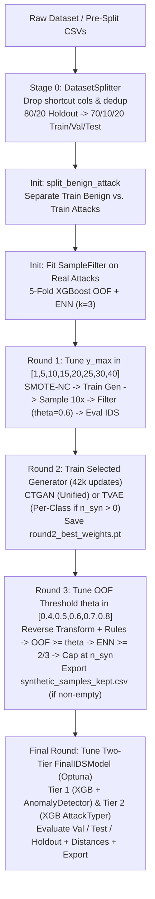

# SAP-DCG Pipeline — Detailed Workflow & Conditional Logic Reference

This document provides a complete, code-verified breakdown of the **SAP-DCG** sequential tuning pipeline across all stages, components, parameters, and **every conditional branch, gate, threshold, and fallback** in the codebase.

---

## 1. End-to-End Workflow Overview



---

## 2. Entrypoint & Orchestrator Initialization

**Files:** `run_pipeline.py`, `orchestration/pipeline_orchestrator.py`

### 2.1 CLI & Path Resolution Conditions
1. **Split CSV Resolution (`run_pipeline.py` lines 47–55):**
   - Each of `--train-csv`, `--val-csv`, `--test-csv`, `--holdout-csv` defaults to `<final_dir>/dev_splits/NF-UNSW-NB15-v3_{train,val,test}.csv` and `<final_dir>/holdout_set/NF-UNSW-NB15-v3.csv`.
   - **Hard Exit Condition:** If any of `train_path`, `val_path`, or `test_path` does not exist, the script prints an error and calls `sys.exit(1)`.
   - **Holdout Condition:** `df_holdout` is loaded only if `holdout_path.exists()`; otherwise `df_holdout = None` (Holdout evaluation is skipped).
2. **Generator Selection (`SequentialTuningPipeline.__init__`, lines 121–134):**
   - `generator_type.lower() == "ctgan"` $\rightarrow$ instantiates `CTGANGenerator(fixed_gradient_updates=42000, random_state=42, weights_dir=output_dir / "weights")`.
   - `generator_type.lower() == "tvae"` $\rightarrow$ instantiates `TVAEGenerator(fixed_gradient_updates=42000, random_state=42, weights_dir=output_dir / "weights")`.
   - Any other value raises `ValueError`.
3. **Default Hyperparameters:**
   - `t_max = 10000`, `initial_ymax = 25`, `epsilon = 0.002`, `fixed_gradient_updates = 42000`, `metric_key = "macro_f1"`, `random_state = 42`.
   - **Note on `epsilon`:** While `epsilon` is stored and logged, `run_pipeline()` (`pipeline_orchestrator.py` line 964) runs **exhaustive candidate evaluation** across Rounds 1–3 without early-stopping between rounds.

---

## 3. Stage 0: Dataset Cleaning, Splitting & Disaggregation

**File:** `components/dataset_splitter.py`

### 3.1 Cleaning (`DatasetSplitter.clean_dataset`, lines 94–109)
- Drops any columns present in `SHORTCUT_COLS` (IPs, ports, timestamps).
- Calls `.drop_duplicates().reset_index(drop=True)`.

### 3.2 Stratified Splitting (`DatasetSplitter.split_train_val_test_holdout`, lines 111–175)
- **Stratification Condition:** Uses `stratify=df["Attack"]` if `"Attack"` is in `df.columns`; otherwise `stratify=None`.
- **Three-Stage Split (single seed `random_state=42`):**
  1. `80%` Development / `20%` Holdout (`holdout_ratio=0.20`).
  2. Development $\rightarrow$ `80%` Train+Val / `20%` Test (`dev_test_ratio=0.20` $\Rightarrow$ `16%` of total).
  3. Train+Val $\rightarrow$ `87.5%` Train / `12.5%` Val (`dev_val_ratio=0.125` $\Rightarrow$ `70%` Train, `10%` Val of Dev).

### 3.3 Benign vs. Attack Disaggregation (`split_benign_attack`, lines 32–72)
- **Condition 1:** If `"Label"` is in `df.columns` $\rightarrow$ `benign_mask = (df["Label"] == 0)`.
- **Condition 2:** Else if `"Attack"` is in `df.columns` $\rightarrow$ `benign_mask = (df["Attack"].astype(str).str.lower() == "benign")`.
- **Condition 3:** Else raises `ValueError`.

---

## 4. Pre-Initialization (Before Round 1)

**File:** `orchestration/pipeline_orchestrator.py` (lines 970–977)

1. Calls `split_benign_attack(train_df)` to cache `self.train_benign` and `self.train_attacks`.
2. Fits `self.sample_filter.fit_oof_predictor(self.train_attacks)` (5-fold StratifiedKFold XGBoost strictly on real attack flows).
3. Fits `self.sample_filter.fit_enn(self.train_attacks)` (`NearestNeighbors(n_neighbors=3)` on `StandardScaler`-normalized real attack flows).

---

## 5. Round 1: Intra-Attack Resampler (`y_max` Tuning)

**Files:** `components/intra_attack_resampler.py`, `orchestration/pipeline_tuner.py`

### 5.1 Synthetic Deficit Calculation (`calculate_synthetic_deficit`, lines 190–253)
For each attack class $c$ with original training count $n_c$:
- **Rare-Boost Condition (lines 209–214):**
  - If `weight_equation in ["custom_rare_boost", "custom_equation"]` **AND** $n_c < \text{median}(\{n_k\})$:
    $$\text{effective\_ymax} = y_{\max} \cdot \left(1.0 + 0.3 \cdot \ln\left(1 + \frac{\text{med}_c}{\max(1, n_c)}\right)\right)$$
  - Otherwise (default `weight_equation` or $n_c \ge \text{med}_c$): $\text{effective\_ymax} = y_{\max}$.
- **Target & Deficit Formula (lines 216–218):**
  $$\text{scaled}_c = \lfloor \text{effective\_ymax} \cdot n_c \rfloor$$
  $$t_c = \max\big(n_c,\ \min(t_{\max},\ \text{scaled}_c)\big)$$
  $$n_{\text{syn}} = \max(0,\ t_c - n_c)$$
  - **Key Consequence when $y_{\max} = 1$:** $t_c = n_c \implies n_{\text{syn}} = 0$ for **every** attack class.

### 5.2 SMOTE-NC Preprocessing & Resampling (`resample_attacks`, lines 255–344)
- **Continuous Sanitization:** Coerces to numeric, replaces $\pm\infty$ with `NaN`, fills `NaN` with column median (or `0.0` if median is `NaN`), then fits & transforms with `self.scaler` (`MinMaxScaler` by default).
- **Categorical Imputation:** If any `NaN` exists in `cat_cols`, fills with column mode (or `0` if mode is empty).
- **Neighbor Count Condition (lines 310–312):**
  - `oversampled_classes = [cls for cls, n_syn in syn_deficit.items() if n_syn > 0]`
  - `min_minority_samples = min(attack_counts[cls] for cls in oversampled_classes)` if `oversampled_classes` is non-empty, else `5`.
  - `k_neighbors = min(5, max(1, min_minority_samples - 1))`.
- **Inverse Transform & Rounding (lines 331–335):** Continuous features are inverse-scaled; all `cat_cols` **except `"L7_PROTO"`** are rounded and cast to `int`.

### 5.3 Round 1 Candidate Evaluation (`tune_resampler_ymax`, lines 230–417)
- **Default Candidates:** `candidate_ymax = [1, 5, 10, 15, 20, 25, 30, 40]`.
- **Optuna vs. Grid Search Condition (line 336):**
  - If `use_optuna=True` and `optuna` is installed: runs `n_trials=8` over `y_max` in `[5, 50]` (step 5).
  - Otherwise (default in `run_pipeline()`): exhaustively evaluates every candidate in `candidate_ymax` with **no early stopping**.
- **Per-Candidate Loop (`_evaluate_candidate`, lines 283–334):**
  1. Runs `IntraAttackResampler.fit_resample(train_df, export=False)`.
  2. If `generator is not None` (active in `SequentialTuningPipeline`):
     - Trains generator on SMOTE-NC resampled attack flows (`Label == 1`).
     - Samples `10 * n_syn` candidate flows (`multiplier=10`).
     - If `sample_filter is not None`: filters with `oof_threshold=0.6`, `run_enn=True`.
     - Concatenates `[train_benign, real_train_attacks, clean_syn]` (note: SMOTE-NC rows are **not** kept in the final IDS training set when `generator` is active; only `real_train_attacks` + `clean_syn` are used).
  3. Else (`generator is None`): uses `out["df_train_resampled"]` directly.
  4. Trains `FinalIDSModel` and evaluates `val_df` on `macro_f1`.
- **Selection Condition (lines 381–386):** Strictly updates `best_y` when `score > best_score`. Saves winning generator weights to `round2_best_weights.pt` (line 206–207) and exports `round1_ymax_tuning.png`.

---

## 6. Round 2: Deep Tabular Generator Training & Sampling

**Files:** `orchestration/pipeline_orchestrator.py` (lines 223–308), `components/ctgan_generator.py`, `components/tvae_generator.py`

### 6.1 Round 2 Orchestration (`run_round2_tune_comp2`)
- **Training Input Condition (lines 248–252):** Uses attack rows (`Label == 1`) from `self.best_train_resampled` (from Round 1's winning `y_max`) if non-empty; otherwise falls back to `real_train_attacks`.
- Trains `self.generators` with `fixed_gradient_updates=42000`, `batch_size=200`, `epochs=None`.
- Saves checkpoint to `output_dir / "round2_best_weights.pt"`.
- Samples `10 * n_syn` candidate flows, filters with default `oof_threshold=0.6`, `run_enn=True`, trains `FinalIDSModel`, and records `round2` metrics.

### 6.2 Epoch & Batch/PAC Constraints (Shared Logic)
- **Epoch Calculation (`calculate_epochs`):**
  $$\text{steps\_per\_epoch} = \max\left(1,\ \left\lfloor\frac{n_{\text{samples}}}{\text{batch\_size}}\right\rfloor\right), \quad \text{epochs} = \min\left(\text{max\_epochs\_cap},\ \left\lceil\frac{42000}{\text{steps\_per\_epoch}}\right\rceil\right)$$
  - Clamped to $\ge 1$. (`max_epochs_cap` is `5000` in CTGAN).
- **CTGAN PAC / Batch Size Constraint (`_resolve_batch_size_and_pac`, `ctgan_generator.py` lines 227–245):**
  - If `n_samples >= 100`: `pac = requested_pac` (default `10`).
  - Else if `n_samples >= 20`: `pac = min(requested_pac, 2)`.
  - Else: `pac = 1`.
  - Ensures `batch_size % pac == 0`, `batch_size % 2 == 0`, and `batch_size <= n_samples`.

### 6.3 CTGAN vs. TVAE Training Conditions
- **CTGAN (`ctgan_generator.py` lines 286–324):**
  - Default `unified_generator=True`: trains **one** `CTGAN` model across all attack flows conditioned on `"Attack"` (included in `discrete_columns`), regardless of whether `syn_deficit` is 0.
  - If `unified_generator=False`: trains per-class models only for `target_classes = [cls for cls, n_syn in syn_deficit.items() if n_syn > 0]`.
- **TVAE (`tvae_generator.py` lines 211–285):**
  - Always trains **per-class** `sdv.single_table.TVAESynthesizer` models **only** for:
    ```python
    target_classes = [cls for cls, n_syn in syn_deficit.items() if n_syn > 0]
    ```
  - **Zero-Deficit Condition (`y_max = 1`):** `TVAEPreprocessor` is still fitted on `train_attacks`, **but `target_classes` is `[]`**, so the training loop executes 0 times, `self.models = {}`, `self.unified_model = None`, and `round2_best_weights.pt` contains no trained neural network.
  - **Sampling (`sample`):** Computes `quotas = {cls: int(multiplier * n) for cls, n in syn_deficit.items() if n > 0}`. If `quotas` is empty, returns an empty `DataFrame`.

---

## 7. Round 3: Synthetic Sample Filtering & Threshold Tuning

**Files:** `components/synthetic_sample_filter.py`, `orchestration/pipeline_tuner.py` (lines 576–683), `orchestration/pipeline_orchestrator.py` (lines 313–370)

### 7.1 Candidate Pool & Threshold Grid
- If `self.best_synthetic_flows` is `None` or empty, Round 3 calls `self.generators.sample(syn_deficit=self.best_syn_deficit, multiplier=10)`.
- **Default Threshold Grid:** `candidate_thresholds = [0.4, 0.5, 0.6, 0.7, 0.8]` (evaluated exhaustively with `run_enn=True`, no early stopping).

### 7.2 Filtering Pipeline Conditions (`filter_samples`, lines 296–427)
1. **Empty Pool Fast-Path (lines 329–345):** If `synthetic_df.empty` (e.g., `y_max=1` with zero deficit), immediately returns empty `kept_df` and `rejected_df` with zero counts.
2. **Reverse Transform & Physical NetFlow Rules (`apply_reverse_transform_and_rules`, lines 93–176):**
   - Inverse-scales `cont_cols` if `scaler` is provided; applies `expm1(clip(lower=0))` if `was_log_transformed=True`.
   - Clips all numeric columns to `>= 0.0`.
   - Rounds & casts to `int` for 21 count/length/TTL/window columns + all `cat_cols` **except `"L7_PROTO"`**.
   - **Rule A (Zero-Packet Zero-Byte):**
     - `(OUT_PKTS == 0) & (OUT_BYTES > 0)` $\rightarrow$ `OUT_BYTES = 0`
     - `(IN_PKTS == 0) & (IN_BYTES > 0)` $\rightarrow$ `IN_BYTES = 0`
   - **Rule B (Non-TCP Zero Flags):**
     - `PROTOCOL != 6` $\rightarrow$ sets `TCP_FLAGS`, `CLIENT_TCP_FLAGS`, `SERVER_TCP_FLAGS` to `0`.
   - **Rule C (Valid Protocol):**
     - `~PROTOCOL.isin(valid_protocols)` $\rightarrow$ replaces with `6` (TCP).
   - **Rule D (Min/Max Ordering Invariants):**
     - `MIN_IP_PKT_LEN > MAX_IP_PKT_LEN` $\rightarrow$ `MAX_IP_PKT_LEN = MIN_IP_PKT_LEN`
     - `SHORTEST_FLOW_PKT > LONGEST_FLOW_PKT` $\rightarrow$ `LONGEST_FLOW_PKT = SHORTEST_FLOW_PKT`
     - `MIN_TTL > MAX_TTL` $\rightarrow$ `MAX_TTL = MIN_TTL`
3. **OOF Confidence Gate (lines 359–361):**
   - Averages `predict_proba` across the 5 real-data XGBoost fold models for each sample's intended `Attack` class.
   - **Keep Condition:** `OOF_Confidence >= oof_threshold` (if intended class is unseen in `label_encoder`, confidence defaults to `0.0`).
4. **ENN Neighborhood Boundary Check (`enn_filter`, lines 266–291):**
   - If `run_enn=True`: finds `k=3` nearest neighbors in `StandardScaler`-normalized real attack space.
   - **Keep Condition:** `agreement_count >= 2` (at least 2 of 3 nearest real neighbors share the synthetic sample's intended `Attack` class); otherwise rejected.
5. **Combined Gate & Deficit Capping (lines 369–380+):**
   - `combined_keep_mask = oof_mask & enn_mask`.
   - If `syn_deficit` is provided: for each class with `n_syn > 0`, ranks passing samples by descending `OOF_Confidence` and caps at `n_syn`.

### 7.3 Export Condition (`pipeline_orchestrator.py` lines 356–359)
- **Non-Empty Export Guard:**
  ```python
  if best_clean_syn is not None and not best_clean_syn.empty:
      kept_syn_path = self.output_dir / "synthetic_samples_kept.csv"
      best_clean_syn.to_csv(kept_syn_path, index=False)
  ```
  - **Pitfall:** If `best_clean_syn` is empty (`y_max=1`), `synthetic_samples_kept.csv` is **not written or cleared**. Reusing the same `output_dir` across runs leaves any prior run's `synthetic_samples_kept.csv` intact.

---

## 8. Final Round: Two-Tier IDS Tuning, Inference & Exports

**Files:** `components/final_ids_model.py`, `orchestration/pipeline_tuner.py` (lines 688–780), `orchestration/pipeline_orchestrator.py` (lines 375–620)

### 8.1 Hyperparameter Search Space (`tune_ids_model`, lines 720–764)
- **Condition:** If `optuna` is installed, runs `n_trials=6` (called from `run_final_round_tune_comp4`) maximizing `val` `macro_f1`:
  - `n_estimators` $\in \{100, 200, 300\}$
  - `max_depth` $\in \{4, 6, 8, 10\}$
  - `learning_rate` $\in [0.03, 0.2]$ (log-uniform)
  - `subsample`, `colsample_bytree` $\in \{0.7, 0.8, 1.0\}$
  - `weight_power` $\in \{0.25, 0.5, 0.75, 1.0\}$
  - `min_confidence` $\in \{0.3, 0.4, 0.5\}$
  - `max_fpr` $\in \{0.005, 0.01, 0.02\}$
- Else: falls back to default `FinalIDSModel` parameters and trains once.

### 8.2 Training Architecture Condition (`FinalIDSModel.train`, lines 366–456)
- `has_benign = (y_tr == 0).any() and (y_tr == 1).any()`
- **If `use_two_tier=True` AND `has_benign`:**
  1. **Tier 1 AnomalyDetector (`AnomalyDetector.fit`):** Fitted on training benign flows and calibrated on validation benign flows (or a 15% `group_split` if `val_df` has no benign flows) at `anomaly_fpr`. Combines `IsolationForest` and `RobustZ` scoring.
  2. **Tier 1 Supervised XGBoost (`tier1_model`):** Binary classifier (`Benign` vs. `Attack`). Threshold calibrated on validation benign scores:
     $$\text{tier1\_thr} = \text{clip}\big(\text{quantile}(\text{ben\_scores},\ 1 - \text{max\_fpr}),\ 0.05,\ 0.95\big)$$
     (Falls back to `0.5` if `len(ben_scores) == 0`.)
  3. **Tier 2 AttackTyper (`tier2_model`):** Multiclass XGBoost trained strictly on `y_tr == 1` (attack flows).
- **Else (Fallback):** Trains a single standalone multiclass XGBoost (`standalone_model`) across all classes.

### 8.3 Class Weighting Conditions (`compute_class_weights`, lines 282–341)
- `"none"` / `"disabled"` / `None` (default): returns `None` (unweighted).
- `"balanced"` / `"balanced_power"`: `compute_sample_weight("balanced", y) ** weight_power`.
- `"custom_rare_boost"` / `"custom_equation"`: multiplies balanced power weight by $1 + \alpha \ln(1 + \text{med\_count}/\max(1, n_c))$ ($\alpha=0.6$), normalized to mean 1.
- `"linear_regression"` / `"linear"`: multiplies by $1 + (n_{\text{classes}} - \text{rank}) / \max(1, n_{\text{classes}})$, normalized to mean 1.

### 8.4 Two-Tier Inference Gates (`FinalIDSModel.predict`, lines 470–491)
For each flow:
1. `hit_s = (sup_score > self.tier1_thr)` (Tier-1 supervised XGBoost alert)
2. `hit_a = (ano_score > 1.0)` (Tier-1 anomaly detector alert)
3. `alert = hit_s | hit_a`
4. Tier-2 predicts `kind = attack_classes_[argmax(P)]` with `conf = max(P)`.
5. **Unknown / Confidence Gates:**
   - If `conf < self.min_confidence` $\rightarrow$ `UNKNOWN`
   - If `hit_a & ~hit_s` (anomaly-only trigger without supervised confirmation) $\rightarrow$ `UNKNOWN`
   - If `~alert` $\rightarrow$ `"Benign"`

### 8.5 Final Exports (`_export_final_pipeline_outputs`, lines 564–620)
- `unsw_nb15_final_pipeline_train.csv` (final resampled training dataset)
- `best_params.json`, `pipeline_tuning_summary.json`, `final_ids_model.joblib`, `evaluation_report.md`
- Distribution distance metrics to `val_df` (`_compute_distribution_distances`: mean normalized Wasserstein distance & centroid Euclidean distance) and 5-pillar synthetic quality report.
- **TVAE Extra Metadata Condition (lines 605–606):** If `generator_type == "tvae"` and `hasattr(self.generators, "get_generator_details")`, attaches `tvae_detailed_summary` to `pipeline_tuning_summary.json`.
