# SAP-DCG Master Pipeline Plan & System Architecture

**Framework Title:** Sequential Adaptive Processing & Deep Conditional Generative Framework (SAP-DCG)  
**Target Dataset:** NF-UNSW-NB15-v3 (NetFlow-v3 Intrusion Detection Benchmark)  
**Core Objective:** Mitigate severe class imbalance and rare attack manifold collapse in high-speed network flows through unified multi-round sequential tuning across SMOTE-NC, CTGAN, protocol-aware sample filtering, and Two-Tier IDS defense.

---

## 1. Executive System Architecture

```mermaid
flowchart TD
    subgraph S1["Phase 1: Partitioning & Shortcut Pruning"]
        RAW["Raw NF-UNSW-NB15-v3.csv"] --> DEDUP["Deduplication & Shortcut Removal\n(IPs, L4 Ports, Timestamps)"]
        DEDUP --> SPLIT["Stratified 80/20 Partitioning"]
        SPLIT --> DEV["80% Dev Set (Train, Val, Test)"]
        SPLIT --> HO["20% Pristine Holdout Set"]
    end

    subgraph S2["Phase 2: Multi-Round Sequential Tuning Pipeline"]
        DEV --> DISAGG["Upfront Partition Disaggregation\n• Split Train into Benign vs Attack flows\n• Pre-fit OOF 5-Fold XGBoost & ENN (k=3) upfront"]
        DISAGG --> R1["Round 1: IntraAttackResampler (SMOTE-NC)\n• Exhaustive evaluation y_max ∈ [1, 5, 10, 15, 20, 25, 30, 40]\n• Compute Deficit Quota n_syn\n• Evaluate on FinalIDSModel (val Macro F1)\n• Plot y_max tuning curve (round1_ymax_tuning.png)"]
        
        R1 --> R2["Round 2: TabularGenerators (CTGAN)\n• Train CTGAN on SMOTE-NC pre-balanced dataset\n• Fixed 42,000 gradient updates\n• Draw 10x n_syn candidate synthetic flows\n• Evaluate on FinalIDSModel"]
        
        R2 --> R3["Round 3: SyntheticSampleFilter\n• NetFlow Domain & Protocol Invariant Rules\n• 5-Fold XGBoost OOF Confidence Gate\n• Edited Nearest Neighbors (ENN, k=3)\n• Exhaustive evaluation θ ∈ [0.4, 0.5, 0.6, 0.7, 0.8]\n• Plot threshold & summary tuning curves"]
        
        R3 --> R4["Final Round: FinalIDSModel Optimization\n• Train on Augmented Data (Real + Clean Synthetic)\n• Optimize Two-Tier Hyperparameters (Optuna)\n• Tier 1: Binary Supervised + IsolationForest Anomaly\n• Tier 2: AttackTyper Multiclass Classifier\n• Unweighted training by default (weight_method='none')"]
    end

    subgraph S3["Phase 3: Multi-Partition Evaluation & Artifact Export"]
        R4 --> EVAL["Comprehensive Benchmark Evaluation\n(Validation, Test, and Holdout Partitions)"]
        EVAL --> ART["Export Destination Directory (--output-dir)\n• evaluation_report.md (Granular Per-Class Metrics)\n• best_params.json (All Optimal Hyperparameters)\n• pipeline_tuning_summary.json (Full Metrics Payload)\n• round2_best_weights.pt (Trained CTGAN Checkpoint)\n• final_ids_model.joblib (Trained Two-Tier IDS)\n• unsw_nb15_final_pipeline_train.csv (Augmented Dataset)\n• synthetic_samples_kept.csv (Clean Synthetic Flows)"]
        ART --> NB["Diagnostic Notebook Visualization\n(nf_unsw_resampling_v2.ipynb)"]
    end
```



---

## 2. Component Specifications & Mathematical Foundations

### 2.1 Component 1: Intra-Attack Resampler ([`IntraAttackResampler`](../components/intra_attack_resampler.py))
- **File:** `SAP-DCG/components/intra_attack_resampler.py`
- **Role:** Data pre-processing, partition isolation, shortcut pruning, and manifold calibration.
- **Shortcut Learning Elimination:** Strips non-generalizable features (`IPV4_SRC_ADDR`, `IPV4_DST_ADDR`, `L4_SRC_PORT`, `L4_DST_PORT`, timestamps) and deduplicates across the remaining 47 NetFlow features to prevent models from memorizing IP/port signatures.
- **Mathematical Synthetic Deficit ($n_{\text{syn}}$) Formulation:**
  For each attack class $c$ with original training count $n_c$, target ceiling $t_{\max} = 10,000$, and multiplier factor $y_{\max}$:
  $$t_c = \max\left(n_c, \min(t_{\max}, y_{\max} \cdot n_c)\right)$$
  $$n_{\text{syn}} = \max\left(0, t_c - n_c\right)$$
- **SMOTE-NC Execution:** Applies Min-Max normalization to continuous features while preserving nominal categorical attributes (`PROTOCOL`, `TCP_FLAGS`, `CLIENT_TCP_FLAGS`, `SERVER_TCP_FLAGS`, `L7_PROTO`) via nearest-neighbor mode-matching.
- **Outputs:** Generates the calibrated `smote-10k` pre-balanced attack dataset and passes the deficit dictionary `syn_deficit` forward.

---

### 2.2 Component 2: Deep Tabular Generators ([`TabularGenerators`](../components/tabular_generators.py))
- **File:** `SAP-DCG/components/tabular_generators.py`
- **Role:** High-dimensional non-linear generation of minority attack flows.
- **Integrated Architecture (Minh's Methodology):**
  - Incorporates `NetFlowPreprocessor` with `np.log1p` transformation on heavy-tailed packet/byte counts.
  - CTGAN generator trained with PAC clustering (`pac = 10` or dynamic PAC alignment based on sample density).
  - Conditional rejection sampling (`sample_by_class`) enforcing strict class condition alignment.
- **Fixed Gradient Update Budget:**
  - Trains under a strict computational budget of **42,000 gradient updates**.
  - Dynamically computes epochs:
    $$\text{steps\_per\_epoch} = \max\left(1, \lfloor n_{\text{samples}} / \text{batch\_size} \rfloor\right)$$
    $$N_{\text{epochs}} = \left\lceil \frac{42,000}{\text{steps\_per\_epoch}} \right\rceil$$
- **Training Input Data:** Receives the SMOTE-NC pre-balanced attack dataset (`self.best_train_resampled[Label == 1]`) to supply sufficient sample density and prevent mode collapse on extreme minority attacks (e.g., Worms, Shellcode).
- **Candidate Pool Sampling:** Generates a candidate surplus of **$10 \times n_{\text{syn}}$** flows per minority class.
- **Post-Sampling Inverse Transformation:** Reverses logarithmic scaling via `np.expm1`, clips features to valid training bounds, and rounds discrete counts to integers.

---

### 2.3 Component 3: Protocol-Aware Synthetic Sample Filter ([`SyntheticSampleFilter`](../components/synthetic_sample_filter.py))
- **File:** `SAP-DCG/components/synthetic_sample_filter.py`
- **Role:** Removing hallucinated, out-of-distribution, or boundary-corrupting synthetic records.
- **Filtering Triad:**
  1. **Domain & Physical Invariant Rules:** Enforces that packet and byte counts cannot be negative, durations must be non-negative, and TCP flags adhere to valid protocol combinations (e.g., no simultaneous SYN+FIN).
  2. **5-Fold Stratified XGBoost OOF Confidence Gate:** Trains an Out-Of-Fold predictor strictly on genuine real attack flows; synthetic flows must achieve a predicted probability $\ge \theta_{\text{OOF}}$ to be considered on-manifold.
  3. **Edited Nearest Neighbors (ENN, $k=3$):** Drops synthetic flows whose nearest neighbors in the combined real manifold belong to a different class, eliminating decision boundary contamination.
- **Selection Quota:** Sorts high-confidence flows and retains the exact deficit $n_{\text{syn}}$ needed per class.

---

### 2.4 Component 4: Two-Tier Intrusion Detection System ([`FinalIDSModel`](../components/final_ids_model.py))
- **File:** `SAP-DCG/components/final_ids_model.py`
- **Role:** Downstream intrusion detection defense, tuning objective function, and multi-pillar quality evaluator.
- **Integrated Architecture (Tuan's ML-IDS Methodology):**
  - **Tier 1 (Benign vs Attack Detector):** Supervised XGBoost classifier combined with an IsolationForest and signed-log robust-Z anomaly detector fitted solely on Benign flows. Calibrated against a target false-alarm ceiling (`max_fpr = 0.01`).
  - **Tier 2 (Multiclass AttackTyper):** Multi-class XGBoost classifier trained on attack flows with optional class weighting (`weight_method="none"` unweighted by default) and confidence thresholding (uncertain predictions categorized as `"Unknown"`).
- **5-Pillar Synthetic Data Quality Evaluation (`evaluate_synthetic_quality`):**
  - **Coverage:** Verified representation across classes.
  - **Validity:** Measurement of invalid rows, negative cells, and fractional counts (Target = $0.00\%$).
  - **Fidelity:** Kolmogorov-Smirnov (KS) statistic, Spearman rank correlation divergence, and tail $q_{99}$ log-ratio.
  - **Privacy:** Exact record copy rate, Distance to Closest Record (DCR) 5th percentile, and closer-to-train rate (~50% neutral target).
  - **Utility:** Machine Learning Efficacy Ratio ($\text{TSTR} / \text{TRTR}$) and Augmentation Gain ($\text{TR+S} - \text{TRTR}$).

---

## 3. Four-Round Sequential Optimization Protocol

The tuning progression is orchestrated by `SequentialTuningPipeline` and `PipelineTuner`:

| Round | Focus Component | Tuned Hyperparameters | Objective / Convergence Criterion |
| :---: | :--- | :--- | :--- |
| **Round 1** | Component 1 (`IntraAttackResampler`) | $y_{\max} \in [1, 5, 10, 15, 20, 25, 30, 40]$ | **Tunes Generator via Downstream Evaluation:** For each candidate $y_{\max}$, resamples train attacks via SMOTE-NC, trains CTGAN with fixed gradient updates, draws $10 \times n_{\text{syn}}$ candidate flows, applies physical checks and OOF filtering, and evaluates validation Macro F1 on `FinalIDSModel`. Computes optimal $n_{\text{syn}}$ quota. Evaluates all candidates exhaustively (no early stopping) and generates the $y_{\max}$ tuning curve plot (`round1_ymax_tuning.png`). |
| **Round 2** | Component 2 (`TabularGenerators`) | Generator Architecture (`ctgan` / `tvae`), `embedding_dim`, `generator_dim`, `discriminator_dim`, `pac`, learning rate, batch size, epochs under 42k steps | Fine-tunes deep generative network structure and training dynamics on the optimal Round 1 pre-balanced attack dataset. Generates $10 \times n_{\text{syn}}$ candidate flows and evaluates on `FinalIDSModel`. Advances unconditionally to Round 3. |
| **Round 3** | Component 3 (`SyntheticSampleFilter`) | OOF confidence gate threshold $\theta_{\text{OOF}} \in [0.4, 0.5, 0.6, 0.7, 0.8]$, ENN neighbor count $k=3$ | Filters candidate pool via domain rules + OOF gate + ENN (pre-fitted upfront on real attacks). Evaluates all threshold candidates exhaustively (no early stopping). Generates threshold tuning curve (`round3_threshold_tuning.png`) and consolidated summary (`tuning_curves_summary.png`). |
| **Final Round** | Component 4 (`FinalIDSModel`) | `n_estimators`, `max_depth`, `learning_rate`, `subsample`, `colsample_bytree`, `min_confidence`, `max_fpr` | Optimizes Two-Tier IDS on final augmented data (`Real Train + Clean Synthetic`). Trains unweighted by default (`weight_method='none'`). Evaluates on Validation, Test, and pristine Holdout sets. |

---

## 4. Hyperparameter Purposes, Mechanisms & Tuning Rationales

This section details the explicit technical and operational purpose of each hyperparameter tuned across the four pipeline components, explaining why tuning it is critical to network intrusion detection and generative balance.

```mermaid
flowchart LR
    subgraph R1_Params["Comp 1: Manifold Density & Quotas"]
        YMAX["y_max: Deficit Multiplier"]
        TMAX["t_max: Class Flow Ceiling"]
    end

    subgraph R2_Params["Comp 2: Deep Generative Dynamics"]
        PAC["pac: PAC-Clustering Mode Penalty"]
        ARCH["DIMS: Generator/Critic Capacity"]
        LR_G["lr: Adam Optimizer Step Size"]
        STEPS["Fixed Updates: 42,000 Steps"]
    end

    subgraph R3_Params["Comp 3: Quality & Boundary Calibration"]
        OOF["theta_OOF: Out-Of-Fold Manifold Gate"]
        ENN["k_ENN: Edited Nearest Neighbor Radius"]
    end

    subgraph R4_Params["Comp 4: Downstream Defense & Class Balance"]
        WP["weight_power: Class Balance Exponent"]
        FPR["max_fpr: Anomaly False Alarm Ceiling"]
        CONF["min_confidence: Tier-2 Rejection Threshold"]
        XGB["XGBoost Hyperparams: depth, lr, subsample"]
    end

    R1_Params --> R2_Params --> R3_Params --> R4_Params
```



### 4.1 Component 1 (Intra-Attack Resampler) Hyperparameters

| Hyperparameter | Search / Candidate Space | Purpose & Technical Mechanism |
| :--- | :--- | :--- |
| **`y_max`** (Multiplication Factor) | $[1, 5, 10, 15, 20, 25, 30, 40]$ | **Purposes:**<br>1. **Governs Synthetic Deficit Quota ($n_{\text{syn}}$):** Controls how aggressively rare minority attack classes (e.g., Worms, Shellcode, Backdoor) are expanded via $t_c = \min(y_{\max} \cdot n_c, t_{\max})$.<br>2. **Tunes the Deep Generator Itself:** Tuning $y_{\max}$ is evaluated by how effectively CTGAN learns and generalizes when trained on that resampled dataset. If $y_{\max}$ is too small, extreme rare classes remain too sparse for the CTGAN discriminator/generator to learn high-dimensional latent structures, leading to severe mode collapse. If $y_{\max}$ is too large, SMOTE-NC creates redundant synthetic collinear interpolations that saturate the attack manifold and cause generator memorization. Downstream validation Macro F1 identifies the optimal trade-off. |
| **`t_max`** (Target Ceiling) | Default: $10,000$ (or dataset-dependent ceiling) | **Purposes:** Prevents majority attack classes (such as Generic or Exploits, which already possess tens of thousands of samples) from exploding in volume, which would swamp the training batch and starve minority classes of generator gradient updates. |
| **`scaler_type`** | `minmax` / `standard` | **Purposes:** Determines normalization for Euclidean distance calculations in SMOTE-NC nearest neighbor searches across mixed continuous and one-hot NetFlow attributes. |

---

### 4.2 Component 2 (Tabular Generators: CTGAN / TVAE) Hyperparameters

| Hyperparameter | Search / Candidate Space | Purpose & Technical Mechanism |
| :--- | :--- | :--- |
| **`generator_type`** | `ctgan` vs `tvae` | **Purposes:** Selects between adversarial training with Wasserstein-GP / PAC clustering (`ctgan`) and probabilistic variational autoencoding (`tvae`). Evaluates which generative paradigm better captures complex multimodal NetFlow distributions. |
| **`fixed_gradient_updates`** | Fixed: $42,000$ steps | **Purposes:** Replaces arbitrary epoch counts with a rigorous, invariant compute budget. Ensures fair comparison across different $y_{\max}$ candidate datasets and batch sizes by guaranteeing that the discriminator and generator always receive identical gradient descent iterations. |
| **`pac`** (Packing Parameter) | $[1, 5, 10]$ (Default: $10$) | **Purposes:** Discriminator grouping parameter in CTGAN. Passing `pac` samples simultaneously to the discriminator penalizes mode collapse by forcing the critic to distinguish between clusters of samples rather than individual points. |
| **`generator_dim` / `discriminator_dim`** | $(128, 128)$ up to $(512, 512, 256)$ | **Purposes:** Sets the capacity of the deep generator and critic networks. Higher capacity captures complex non-linear feature interactions between packet lengths, inter-arrival times, and TCP state flags, but requires sufficient sample density to avoid overfitting. |
| **`embedding_dim`** | $64, 128, 256$ | **Purposes:** Dimension of the latent noise vector $z \sim \mathcal{N}(0, I)$ mapped into synthetic network flow space. |
| **`learning_rate`** | $1 \times 10^{-4}$ to $5 \times 10^{-4}$ | **Purposes:** Stabilizes Adam optimizer updates between the generator and discriminator, preventing generator divergence or vanishing gradients. |
| **`batch_size`** | $200, 500$ | **Purposes:** Governs the empirical distribution estimate per gradient step. Balanced against the fixed 42,000 update budget to dictate total training exposure. |

---

### 4.3 Component 3 (Synthetic Sample Filter) Hyperparameters

| Hyperparameter | Search / Candidate Space | Purpose & Technical Mechanism |
| :--- | :--- | :--- |
| **`oof_threshold` ($\theta_{\text{OOF}}$)** | $[0.4, 0.5, 0.6, 0.7, 0.8]$ | **Purposes:**<br>1. **Out-Of-Fold Manifold Gatekeeper:** Evaluates synthetic flow probability scores output by a 5-fold cross-validated XGBoost model trained exclusively on authentic attack flows.<br>2. **Hallucination Rejection:** Synthetic flows with predicted probability $< \theta_{\text{OOF}}$ are discarded as unrealistic hallucinations or off-manifold artifacts.<br>3. **Precision vs Diversity Trade-off:** A higher threshold retains only textbook, highly-confident attack representations but risks dropping novel boundary variations; a lower threshold preserves diverse boundary samples but risks injecting noisy flows. |
| **`enn_neighbors` ($k$)** | $3, 5$ (Default: $3$) | **Purposes:** Neighborhood radius for Edited Nearest Neighbors. Identifies and removes synthetic flows whose $k$ nearest neighbors in the combined real dataset belong to a different class. Prevents synthetic attack samples from blurring the boundary with benign traffic or interfering with adjacent attack classes. |
| **`multiplier`** | Default: $10 \times n_{\text{syn}}$ | **Purposes:** Governs rejection sampling overgeneration. Generating a $10\times$ candidate pool ensures that even after strict physical checks, OOF gating, and ENN pruning, an exact quota of $n_{\text{syn}}$ high-fidelity samples remains available for final dataset augmentation. |

---

### 4.4 Component 4 (Final IDS Model: Two-Tier Defense) Hyperparameters

| Hyperparameter | Search / Candidate Space | Purpose & Technical Mechanism |
| :--- | :--- | :--- |
| **`weight_method`** / **`weight_power`** | `weight_method`: `none` (default), `balanced_power`, `custom_rare_boost`, `linear_regression`<br>`weight_power`: $[0.0, 0.25, 0.5, 0.75, 1.0]$ | **Purposes:** Optional class imbalance compensation in the Tier-2 multiclass loss function. Disabled by default (`weight_method="none"`, `sample_weight=None`). When enabled with `balanced_power`, weights scale as $w_c = (N_{\text{total}} / N_c)^{\text{weight\_power}}$. Setting `weight_power = 0.5` implements square-root class balancing. |
| **`max_fpr`** | $[0.005, 0.01, 0.02, 0.05]$ | **Purposes:** False Alarm Rate ceiling for Tier-1 benign traffic defense. The threshold for the Tier-1 binary classifier and anomaly detector is calibrated against validation benign traffic such that the false positive rate never exceeds `max_fpr` (critical in enterprise networks to prevent alert fatigue). |
| **`min_confidence`** | $[0.3, 0.4, 0.5, 0.6]$ | **Purposes:** Threshold for Tier-2 multiclass classification. If the top predicted attack class probability is below `min_confidence`, the flow is labeled as `"Unknown Attack"` for SOC analyst inspection rather than risking a confident misclassification. |
| **`max_depth`** | $[4, 6, 8, 10]$ | **Purposes:** Controls tree depth in XGBoost. Shallow trees prevent memorization of noise in sparse minority classes, while deeper trees capture complex multi-feature intrusion patterns. |
| **`learning_rate` (`eta`)** | $[0.01, 0.05, 0.1, 0.2]$ | **Purposes:** Step size shrinkage used in gradient boosting updates to prevent overfitting on augmented synthetic records. |
| **`subsample` / `colsample_bytree`** | $[0.6, 0.8, 1.0]$ | **Purposes:** Row and feature subsampling ratios per tree split, introducing stochastic gradient boosting regularization to improve generalization on unseen network traffic. |

---

## 5. Execution Workflow & Usage Guide

### 5.1 Running the End-to-End Pipeline
Execute the master runner with custom destination output directory:

```bash
# Full execution with CTGAN generator and 0.002 convergence epsilon
python SAP-DCG/run_pipeline.py \
    --generator ctgan \
    --epsilon 0.002 \
    --t-max 10000 \
    --fixed-updates 42000 \
    --output-dir SAP-DCG/results
```

### 5.2 Inspecting Visualizations & Diagnostics
All generated artifacts in the destination folder are automatically visualized by:
- **Notebook:** `SAP-DCG/notebooks/nf_unsw_resampling_v2.ipynb`
- Displays multi-split defense radars, per-class precision/recall/F1 bar charts, normalized confusion matrices, 5-pillar synthetic quality dashboards, and continuous Wasserstein distance charts.

---

## 6. Artifact Deliverables Manifest

When the pipeline completes, the destination folder (`--output-dir`) contains:

| Filename | Format | Description |
| :--- | :--- | :--- |
| `evaluation_report.md` | Markdown | Comprehensive report with side-by-side overall benchmarks, detailed per-class metrics, confusion matrices, 5-pillar quality diagnostics, candidate evaluation tables, and embedded tuning plots. |
| `round1_ymax_tuning.png` | PNG Plot | Tuning curve across SMOTE-NC multiplication factors $y_{\max} \in [1, 5, 10, 15, 20, 25, 30, 40]$. |
| `round3_threshold_tuning.png` | PNG Plot | Tuning curve across OOF filter confidence thresholds $\theta_{\text{OOF}} \in [0.4, 0.5, 0.6, 0.7, 0.8]$. |
| `tuning_curves_summary.png` | PNG Plot | Consolidated two-panel tuning summary comparing Round 1 and Round 3 optimization. |
| `best_params.json` | JSON | Optimal configuration and parameters across all four components. |
| `pipeline_tuning_summary.json` | JSON | Complete structured numerical metrics for programmatic analysis. |
| `round2_best_weights.pt` | PyTorch | Serialized weights and preprocessor state for the trained CTGAN model. |
| `final_ids_model.joblib` | Model State | Trained Two-Tier IDS detector (Tier-1 supervised detector, Anomaly detector, Tier-2 AttackTyper). |
| `unsw_nb15_final_pipeline_train.csv` | CSV | Final augmented NetFlow training set with balanced minority attack classes. |
| `synthetic_samples_kept.csv` | CSV | Filtered high-fidelity synthetic flows generated by CTGAN. |

